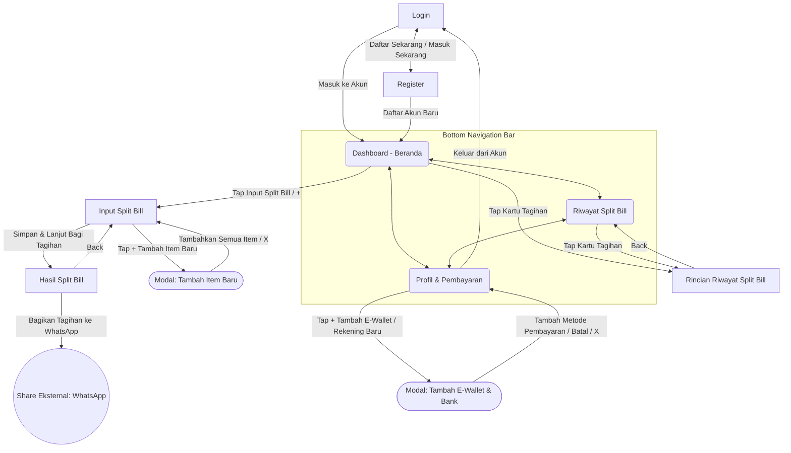

# Dokumentasi Screen Flow — Aplikasi SplitIn

Dokumen ini menjelaskan struktur navigasi, inventaris lengkap 13 status layar (*screen states*), komponen antarmuka, serta rincian alur interaksi pengguna pada aplikasi **SplitIn**.

---

## 1. Peta Navigasi Utama (Navigation Map)

Aplikasi memiliki struktur navigasi yang terbagi menjadi **Autentikasi (Login & Register)**, **Navigasi Utama (Bottom Tab Bar)**, **Alur Transaksi Split Bill**, serta **Manajemen Riwayat & Pembayaran**.

---

## 2. Inventaris Lengkap Layar & Status (13 Screens)

Berikut adalah rincian dari ke-13 layar dan *state* yang terdapat dalam desain aplikasi:

| No | File Referensi | Nama Layar | Tipe / Letak | State / Kondisi | Deskripsi Singkat |
| :-- | :--- | :--- | :--- | :--- | :--- |
| 1 | `Login.png` | **Masuk Akun** | Full Screen (Auth) | Default | Halaman autentikasi pengguna lama untuk masuk ke akun SplitIn. |
| 2 | `Register.png` | **Daftar Akun** | Full Screen (Auth) | Default | Halaman pendaftaran pengguna baru untuk membuat akun SplitIn. |
| 3 | `Dashboard (Idle).png` | **Dashboard Split Bill** | Tab Utama (Beranda) | *Idle / Empty* | Tampilan beranda saat pengguna belum memiliki catatan tagihan aktif (`0 Tagihan`). |
| 4 | `Dashboard (Terisi).png` | **Dashboard Split Bill** | Tab Utama (Beranda) | *Terisi (Populated)* | Tampilan beranda yang memuat ringkasan daftar tagihan aktif dan selesai (`3 Tagihan`). |
| 5 | `Input Split Bill.png` | **Input Split Bill** | Sub-Page | Active / Form | Halaman pencatatan detail tempat, daftar pemesan, item menu, pajak, dan diskon. |
| 6 | `Tambah Item Baru (Modal Input).png` | **Tambah Item Baru** | Bottom Sheet / Modal | Overlay | Form modal untuk menambahkan satu atau beberapa menu sekaligus ke satu pemesan. |
| 7 | `Hasil Split Bill.jpg` | **Hasil Split Bill** | Sub-Page | Summary | Halaman ringkasan pembagian akhir per orang, status pelunasan, QRIS/rekening, dan tombol share. |
| 8 | `Riwayat Split Bill (Idle).png` | **Riwayat Split Bill** | Tab Utama (Riwayat) | *Idle / Empty* | Halaman pencarian dan filter riwayat tagihan saat data masih kosong. |
| 9 | `Riwayat Split Bill.png` | **Riwayat Split Bill** | Tab Utama (Riwayat) | *Terisi (Populated)* | Halaman statistik pengeluaran bulanan dan daftar riwayat tagihan dikelompokkan per bulan. |
| 10 | `Rincian Riwayat Split Bill.jpg` | **Rincian Pembayaran** | Sub-Page | Detail & Edit | Halaman detail progres pembayaran tagihan, verifikasi manual Host, serta rincian item struk. |
| 11 | `Profile & Pembayaran (Idle).png` | **Profil & Pembayaran** | Tab Utama (Profil) | *Idle / Empty* | Pengaturan profil & QRIS saat belum ada rekening/e-wallet tertaut (`0 Terhubung`). |
| 12 | `Profile & Pembayaran.png` | **Profil & Pembayaran** | Tab Utama (Profil) | *Terisi & Edit Inline* | Pengaturan profil dengan daftar metode pembayaran aktif serta mode sunting (*inline edit*). |
| 13 | `Tambah E-Wallet & Bank (Pop-up Modal).png` | **Tambah E-Wallet / Bank** | Pop-up Modal | Overlay | Form modal untuk menautkan akun E-Wallet atau rekening bank baru. |

---

## 3. Rincian Alur Pengguna (User Flows)

### A. Alur Autentikasi (`Login.png` & `Register.png`)
1. **Masuk Akun (`Login.png`)**:
   * Pengguna mengisi **Nama Pengguna / Lengkap** (*Wajib*) dan **Alamat Email** (*Wajib*), serta opsional mencentang **Ingat saya**.
   * Menekan **Masuk ke Akun** $\rightarrow$ Masuk ke **Dashboard Split Bill**.
   * Jika belum memiliki akun, menekan tautan **Daftar Sekarang** $\rightarrow$ Beralih ke layar **Register**.
2. **Daftar Akun (`Register.png`)**:
   * Pengguna mengisi **Nama Pengguna / Lengkap**, **Alamat Email**, dan **Kata Sandi** (*Minimal 8 karakter*, dilengkapi ikon *toggle* visibilitas kata sandi).
   * Menekan **Daftar Akun Baru** $\rightarrow$ Akun dibuat dan diarahkan ke **Dashboard Split Bill** (*Idle State*).
   * Jika sudah memiliki akun, menekan tautan **Masuk Sekarang** $\rightarrow$ Kembali ke layar **Login**.

---

### B. Alur Beranda & Pembuatan Split Bill (`Dashboard`, `Input Split Bill`, `Tambah Item Baru`)
1. **Layar Beranda (`Dashboard (Idle).png` & `Dashboard (Terisi).png`)**:
   * Menampilkan sapaan pengguna (*"Selamat sore Raka!"*), ikon notifikasi dengan indikator titik merah, serta kartu CTA utama **Input Split Bill** (`+`).
   * Pada state **Terisi**, menampilkan filter tab (*Semua*, *Belum Lunas*, *Lunas*) dan kartu tagihan dengan kode warna status (hijau/biru untuk *Belum Lunas*, krem untuk *Lunas*) beserta indikator progres pelunasan (misal: `3/5 orang lunas`).
   * Menekan kartu **Input Split Bill (+)** $\rightarrow$ Masuk ke layar **Input Split Bill**.
2. **Layar Input Split Bill (`Input Split Bill.png`)**:
   * Pengguna dapat mengedit nama tempat/merchant dan waktu transaksi di kartu bagian atas.
   * **Daftar Item & Rincian**: Menampilkan kelompok pesanan per anggota (*Raka*, *Dimas & Sarah*, *Alisha*, *Kevin*), masing-masing dengan tombol edit (pensil) dan hapus (tempat sampah).
   * Menekan **+ Tambah Item Baru** $\rightarrow$ Membuka modal **Tambah Item Baru**.
3. **Modal Tambah Item Baru (`Tambah Item Baru (Modal Input).png`)**:
   * Pengguna mengisi **Nama Pemesan / Anggota** serta daftar menu (nama item, tombol `-`/`+` untuk jumlah porsi, dan harga satuan).
   * Dapat menambahkan beberapa baris menu untuk pemesan yang sama melalui tombol **+ Tambah Menu**.
   * Sistem menghitung *Total Keseluruhan* porsi & nominal secara otomatis.
   * Menekan **Tambahkan Semua Item** $\rightarrow$ Data masuk ke daftar item di layar **Input Split Bill**.
4. **Kalkulasi Biaya Tambahan (`Input Split Bill.png`)**:
   * Pada kartu **Biaya Layanan & Diskon**, pengguna menyesuaikan *Subtotal Pesanan*, *Pajak Resto (PB1)*, *Service Charge*, *Voucher / Diskon*, dan *Pembulatan Kasir* agar sesuai dengan *Total Akhir Struk*.
   * Menekan **Simpan & Lanjut Bagi Tagihan** $\rightarrow$ Masuk ke layar **Hasil Split Bill**.

---

### C. Alur Ringkasan & Penagihan (`Hasil Split Bill.jpg`)
1. **Layar Hasil Split Bill**:
   * Menampilkan notifikasi sukses (*"Perhitungan berhasil dibagi adil & presisi!"*) dan kartu ringkasan total tagihan, jumlah pembagian, serta jumlah item.
   * **Rincian per Orang**: Menampilkan nominal bersih tiap orang (termasuk item *shared* dan penyesuaian pajak/diskon), *toggle switch* status **Lunas**, dan tombol **Salin** untuk menyalin tagihan individu.
   * **Tujuan Transfer (Kamu)**: Menampilkan rekening utama (*Default*) beserta tombol salin, serta panel **QRIS Dinamis (Siap Scan)** yang dapat dibuka/tutup (*collapsible*).
   * Menekan **Bagikan Tagihan ke WhatsApp** $\rightarrow$ Membuka aplikasi WhatsApp untuk membagikan rincian tagihan ke grup/teman.

---

### D. Alur Riwayat & Verifikasi Pelunasan (`Riwayat Split Bill` & `Rincian Riwayat Split Bill`)
1. **Layar Riwayat Split Bill (`Riwayat Split Bill (Idle).png` & `Riwayat Split Bill.png`)**:
   * Diakses melalui tab **Riwayat** di *Bottom Navigation Bar*.
   * Dilengkapi fitur pencarian tempat/teman, filter rentang waktu (*Bulan Ini*, *Pilih Tanggal*), tombol urutkan (*sort*), dan tab status (*Semua*, *Belum Lunas*, *Lunas*).
   * Pada state **Terisi**, menampilkan kartu ringkasan **Total Split Bill Bulan Ini** (total nominal, *Bagian Kamu*, dan *Sudah Dibayar Teman*) diikuti daftar transaksi yang dikelompokkan berdasarkan bulan (*April 2025*, *Maret 2025*).
   * Menekan salah satu kartu transaksi $\rightarrow$ Masuk ke layar **Rincian Pembayaran**.
2. **Layar Rincian Pembayaran (`Rincian Riwayat Split Bill.jpg`)**:
   * Menampilkan kartu header status tagihan (misal: `Belum Lunas (3/5 Terbayar)`), total transaksi, nominal *Tagihanmu*, dan *Sisa Tagihan Teman*.
   * **Progres Pembayaran (Verifikasi Manual Host)**:
     * Menampilkan *progress bar* persentase pelunasan (misal: `75%`, terkumpul Rp 140.000 dari Rp 185.000).
     * Menampilkan daftar status setiap anggota (otomatis *Lunas* untuk Host, informasi metode & waktu bayar untuk yang sudah lunas, serta status *Menunggu Konfirmasi* / *Menunggu Transfer*).
     * Host dapat menekan ikon edit (pensil) pada anggota yang belum bayar untuk membuka panel inline: mengaktifkan toggle **Lunas**, memilih metode pembayaran (**Cash**, **QRIS**, **Transfer**), lalu menekan **Simpan** (waktu pelunasan tercatat otomatis).
   * **Item Pesanan Struk**: Bagian *accordion* di bawah yang merinci seluruh item pesanan beserta pembagian pemesannya, subtotal, pajak PB1, service/pembulatan, hingga total akhir struk.

---

### E. Alur Profil & Metode Pembayaran (`Profile & Pembayaran` & `Tambah E-Wallet & Bank`)
1. **Layar Profil & Pembayaran (`Profile & Pembayaran (Idle).png` & `Profile & Pembayaran.png`)**:
   * Diakses melalui tab **Profil** di *Bottom Navigation Bar*.
   * Menampilkan kartu identitas pengguna (foto, nama, nomor HP, tombol edit) dan kartu **QRIS Instan Split Bill** dengan status *Aktif* serta tombol **Unggah / Ganti Foto QR**.
   * **E-Wallet & Rekening Bank**:
     * Pada state **Idle** (`0 Terhubung`), menampilkan ajakan untuk menambahkan metode pembayaran pertama.
     * Pada state **Terisi** (`3 Terhubung`), menampilkan daftar akun tersimpan (OVO, DANA, BCA) beserta tombol salin nomor dan edit. Menekan tombol edit akan membuka form *inline* pada kartu untuk mengubah nama/nomor akun dan mengatur *toggle* **Jadikan pembayaran default**.
2. **Modal Tambah E-Wallet & Bank (`Tambah E-Wallet & Bank (Pop-up Modal).png`)**:
   * Muncul saat pengguna menekan **+ Tambah E-Wallet / Rekening Baru**.
   * Pengguna memilih penyedia **E-Wallet / Bank**, mengisi **Nomor / ID Akun**, dan **Nama Pemilik Akun (Sesuai Aplikasi)**.
   * Menekan **Tambah Metode Pembayaran** untuk menyimpan atau **Batal** / `X` untuk membatalkan.
3. **Keluar Akun**:
   * Menekan tombol **Keluar dari Akun** di bagian bawah layar Profil $\rightarrow$ Mengakhiri sesi dan kembali ke layar **Login**.